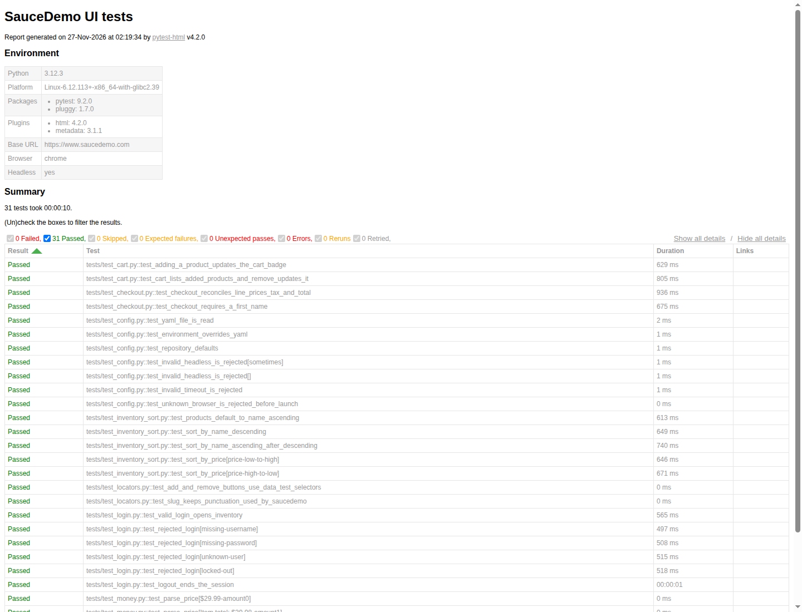

# SauceDemo UI automation

[](https://github.com/Potucky/selenium-pytest-page-object/actions/workflows/ui-tests.yml)

Selenium + pytest UI framework for the public [SauceDemo](https://www.saucedemo.com) store. It uses the Page Object Model, explicit waits, and a checkout check that reconciles line prices, tax, and the order total.

This is a personal portfolio demo for QA Automation, SDET, and Data QA roles. It is not employer code and it is not a production suite.

[Live test report](https://potucky.github.io/selenium-pytest-page-object/)

The badge tracks the default branch of `Potucky/selenium-pytest-page-object`. The live report is published on each push to `main` when GitHub Pages uses GitHub Actions as its source.

## What this project demonstrates

- **Page Object Model.** Selenium 4 page objects for login, inventory, cart, and checkout own the locators and actions. Tests own the assertions.
- **Functional UI checks, including negative cases.** Valid login, missing fields, a bad password, the locked-out user, logout, name and price sorting, and cart updates. Each UI test gets its own browser and waits for the screen to change.
- **On-screen price reconciliation.** The checkout test reads item prices from the inventory and checks those same amounts, 8% tax rounded half up to the cent, and the order total on the overview.
- **CI test reports.** GitHub Actions runs the suite in headless Chrome and stores a self-contained HTML report, JUnit XML, and a screenshot when a test fails. Pushes to `main` also publish the HTML report.
- **Configurable runs.** Defaults live in `config/settings.yaml` and are overridden by environment variables. Separate fast tests cover the settings loader, price parser, tax rounding, and locators without opening a browser.

## What it demonstrates

- Page objects for login, inventory, cart, and checkout
- Login with a valid user, a bad password, missing fields, and the locked-out user
- Logout, including a check that the inventory URL is no longer available
- Sorting by name and by price
- Cart badge, line items, and removal
- Checkout validation, then a completed order whose subtotal, 8% tax, and total agree
- Settings in `config/settings.yaml`, overridden by environment variables
- Headless Chrome in CI, HTML and JUnit reports, and a screenshot on failure

## Tech stack

| Piece | Choice |
| --- | --- |
| Language | Python 3.12 |
| Browser automation | Selenium 4 (Selenium Manager resolves ChromeDriver) |
| Test runner | pytest |
| Reports | pytest-html (self-contained HTML) and pytest JUnit XML |
| Config | YAML plus `BASE_URL`, `BROWSER`, `HEADLESS`, `TIMEOUT` |
| CI | GitHub Actions, headless Chrome on `ubuntu-latest` |

## Project structure

```
config/settings.yaml          default base URL, browser, headless, timeout
framework/                    settings, Chrome driver, price parsing, demo users
pages/                        page objects
tests/                        UI scenarios plus fast checks for config, prices, locators
.github/workflows/ui-tests.yml
.github/workflows/pages.yml   publish the HTML report on pushes to main
reports/                      generated HTML and JUnit XML (not committed)
screenshots/                  PNG saved when a test fails (not committed)
```

## Run locally

Python 3.12 and Google Chrome are required. ChromeDriver is downloaded by Selenium Manager on the first run.

```bash
python -m venv .venv
source .venv/bin/activate   # Windows: .venv\Scripts\activate
pip install -r requirements.txt
python -m pytest
```

There is no display on a CI runner or a remote shell, so turn headless mode on:

```bash
HEADLESS=true python -m pytest
```

Useful subsets:

```bash
python -m pytest -m smoke       # valid login and the full checkout
python -m pytest -m "not ui"    # config, price, and locator checks only
python -m pytest tests/test_login.py
```

A full local run is well under a minute. One headless run of this suite finished in about 10 seconds with 31 passed.

## Configuration

`config/settings.yaml` holds the defaults. Environment variables override the file.

| Variable | Default | Purpose |
| --- | --- | --- |
| `BASE_URL` | `https://www.saucedemo.com` | Site under test |
| `BROWSER` | `chrome` | Only Chrome is supported |
| `HEADLESS` | `false` | `true` or `false`. CI sets `true` |
| `TIMEOUT` | `15` | Explicit-wait timeout in seconds |

Implicit waits are left at 0. Tests wait for a visible element, a URL, or a cart badge.

## Reports

`python -m pytest` writes:

- `reports/report.html` — self-contained HTML report
- `reports/junit.xml` — JUnit XML

Open the HTML file in a browser. The environment block shows the base URL, browser, and headless flag. When a test fails during the test body, the report embeds a screenshot and the same PNG is saved under `screenshots/`. The sample below is a passing run, so the Links column is empty.

The same HTML report is published from `main`: [Live test report](https://potucky.github.io/selenium-pytest-page-object/).

## Sample output

```text
$ HEADLESS=true python -m pytest
...............................                                          [100%]
31 passed in 10.23s
```



## Test approach

Each UI test gets its own browser, so cookies and cart contents do not leak between tests. Page objects own locators and actions. Tests own the assertions.

Waits are `WebDriverWait` checks: the inventory list has reordered, the Remove button has replaced Add to cart, the cart badge shows the expected count, or the URL has changed. There is no `time.sleep`.

Two SauceDemo behaviors in headless Chrome are handled on purpose:

- A WebDriver pointer click on the menu button opens the menu and closes it again in the same gesture, and some inventory buttons ignore the hit. `BasePage.click` fires the DOM click event React listens for, then the test waits until the screen actually changes.
- `element.clear()` desynchronizes the checkout form, so later keystrokes never appear. `BasePage.fill` sets the input the way React expects and waits until the field shows that value.

Prices use `Decimal`, not floats. SauceDemo tax is 8% of the item total, rounded half up to the cent. The checkout test reads the prices on the inventory cards, checks those same amounts on the overview, and checks that tax and total follow that rule. For the backpack (`$29.99`) and bike light (`$9.99`) that is a `$39.98` subtotal, `$3.20` tax, and a `$43.18` total.

## Scenario coverage

Covered against the live demo site:

- Valid login, unknown user, missing username, missing password, locked-out user, logout
- Default name order, Z-to-A, back to A-to-Z, price low-to-high, price high-to-low
- Add one item (badge), add two items (order and prices), remove one
- Checkout with an empty form, and a purchase whose money adds up

Not covered, on purpose for a small demo:

- `problem_user`, `performance_glitch_user`, `error_user`, and `visual_user`
- Other browsers, mobile viewports, and visual regression
- API calls or network stubs. Every UI test uses the public site

The fast tests (no browser) cover the settings loader, the price parser, the tax rounding, and the `data-test` slugs, including `Test.allTheThings() T-Shirt (Red)`.

## Continuous integration

`.github/workflows/ui-tests.yml` runs on pushes to `main`, on pull requests into `main`, and on manual dispatch. The job installs the pinned requirements, runs `python -m pytest` with `HEADLESS=true`, and always uploads `reports/` and `screenshots/` as the `test-report` artifact (kept for 14 days).

`.github/workflows/pages.yml` runs on pushes to `main` and on manual dispatch. It runs the same suite, writes an `index.html` that links to the HTML report, and deploys both with `actions/upload-pages-artifact` and `actions/deploy-pages`. The site is [https://potucky.github.io/selenium-pytest-page-object/](https://potucky.github.io/selenium-pytest-page-object/). That address serves the report after the workflow succeeds. The repository Pages source has to be GitHub Actions (Settings → Pages).

## Demo accounts

SauceDemo prints these accounts on its login page. They are public demo credentials, not secrets, and nothing else is stored in this repo.

| User | Password | Used for |
| --- | --- | --- |
| `standard_user` | `secret_sauce` | The scenarios that sign in |
| `locked_out_user` | `secret_sauce` | The locked-account error |

## Author

Vasyl Popovich, QA Automation Engineer, Miami, FL. GitHub: https://github.com/Potucky
